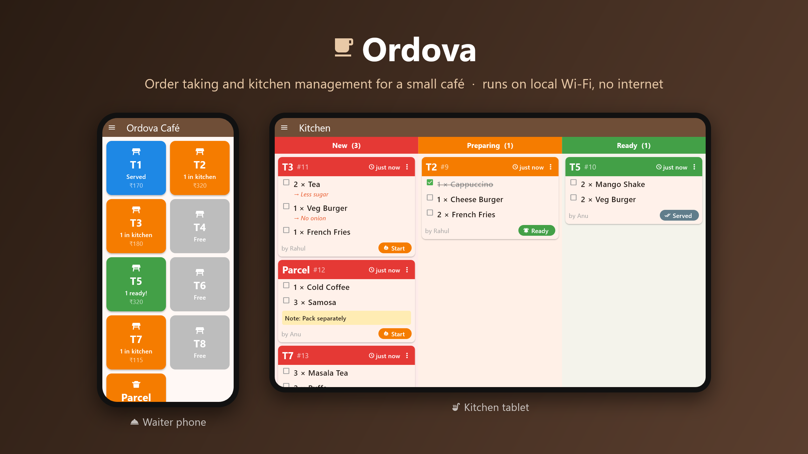
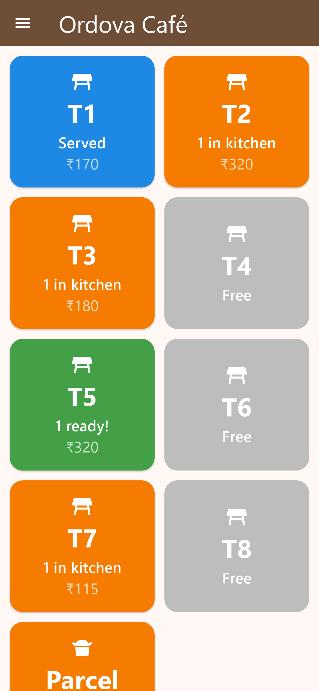
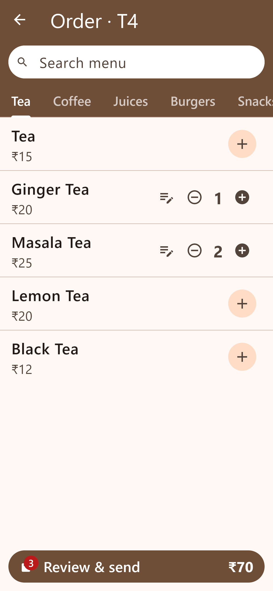
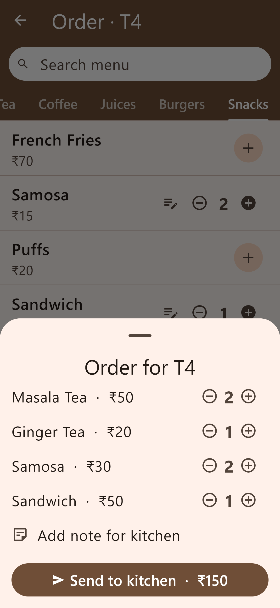
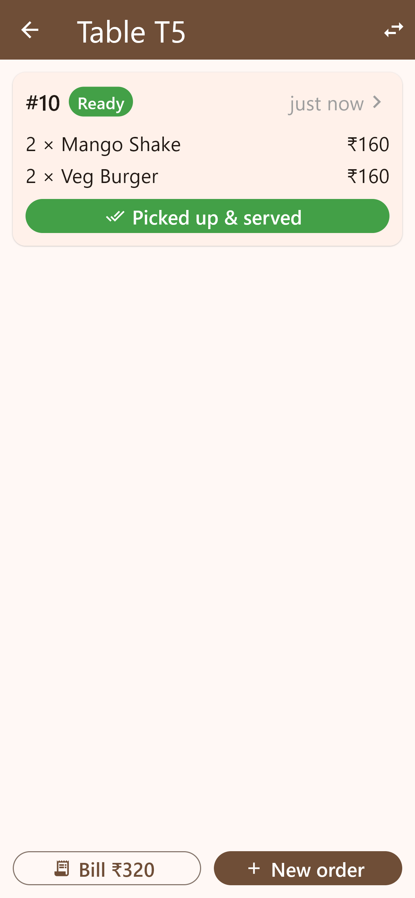
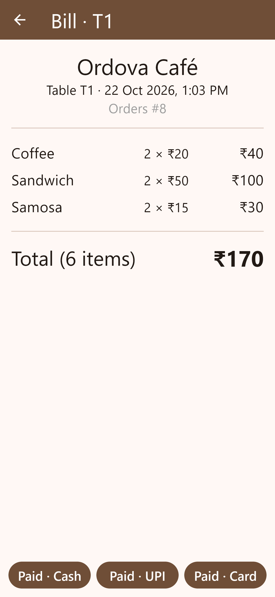
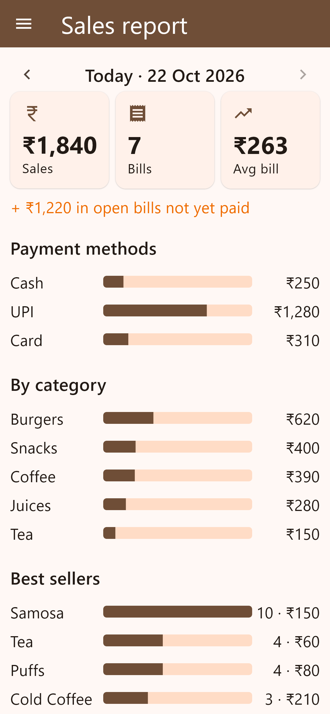
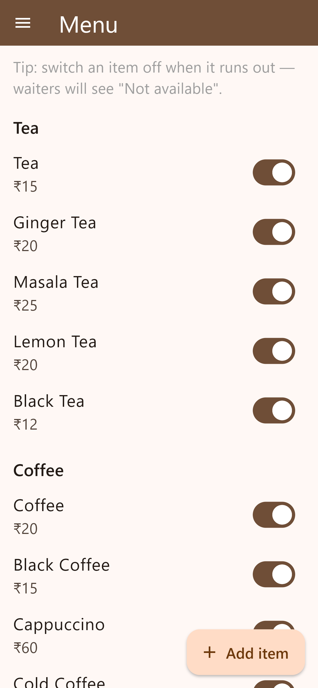
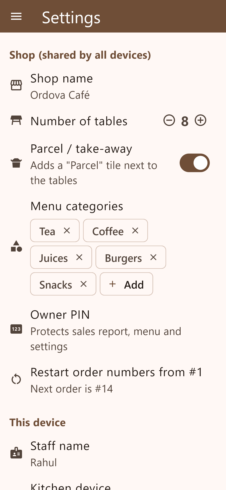
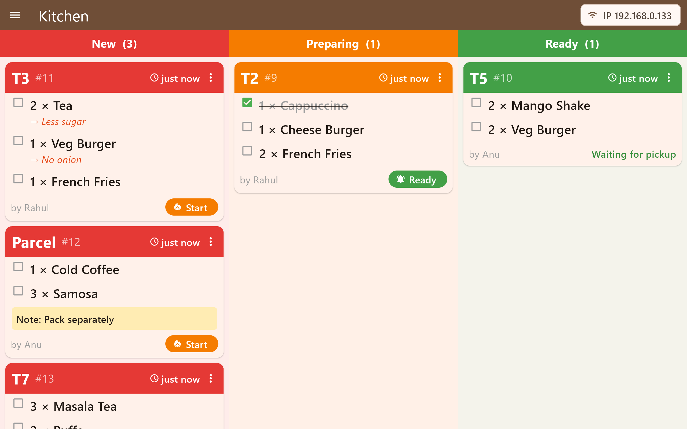

# Ordova



Order taking and kitchen management for a small café. Works on the shop's Wi-Fi only: no internet, no account, no monthly cost.

- **Kitchen device (ground floor)**: holds all data, shows the live ticket board, beeps on new orders.
- **Waiter phones (first floor)**: pick a table, add items, send to kitchen, get a sound when an order is ready.

## Screenshots

| Tables | Taking an order | Review & send | Order ready |
|---|---|---|---|
|  |  |  |  |

| Bill | Sales report | Menu | Settings |
|---|---|---|---|
|  |  |  |  |

**Kitchen board (tablet)**



## Setup in the shop

1. Install the APK (`build/app/outputs/flutter-apk/app-release.apk`) on every device.
2. Connect all devices to the **same Wi-Fi** (a phone hotspot works too).
3. On the kitchen tablet: open Ordova and choose **Kitchen**. Its IP is shown at the top.
4. On each waiter phone: open Ordova and choose **Waiter**. The kitchen should appear automatically; tap it. If it doesn't, type the IP.
5. Open **Menu** from the side drawer (owner PIN, default `1234`) and set real items and prices. Change the PIN in **Settings**.

Tip: give the kitchen tablet a fixed IP (DHCP reservation) in the router so waiters never need to reconnect.

## Features

- Tables grid with live status: free, in kitchen, ready, served/unpaid. Includes a Parcel tile for take-away.
- Ordering by category, with search, quantities, per-item notes (less sugar, no onion…) and an order note.
- Kitchen board: New → Preparing → Ready → Served. Tap items to tick them off, and the ticket goes Ready automatically when all are done. Tickets waiting 10+ minutes get a red border.
- Ready alerts on waiter phones.
- Billing: merges all of a table's orders into one bill. Mark paid by Cash / UPI / Card. Move a table's bill to another table.
- Sales report by day: total, number of bills, average bill, payment split, sales by category, best sellers, busy hours.
- Menu management: add, edit or delete items, and switch an item off when it runs out.
- Settings: shop name, number of tables, categories, PIN, restart order numbers each day.

## Development

```
flutter pub get
flutter test        # starts a real server + client on localhost
flutter build apk --release

# regenerate the screenshots in screenshots/
flutter test integration_test/screenshots_test.dart -d windows --dart-define=OUT_DIR=screenshots
```

Code layout:

- `lib/server/kitchen_server.dart`: HTTP/WebSocket server on port 4567, JSON file storage, UDP discovery beacon on port 4568.
- `lib/client/ordova_client.dart`: WebSocket client with auto-reconnect. Every screen uses it, including on the kitchen device.
- `lib/models.dart`: menu, orders, settings.
- `lib/ui/`: screens.
